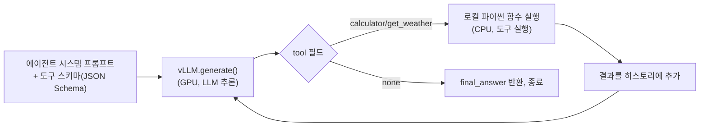
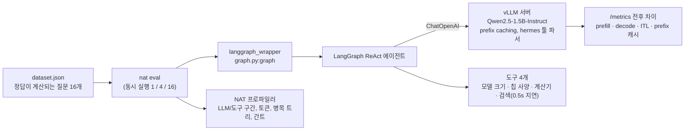

# 에이전트 루프 병목 실측 — 오픈 모델 기반

vLLM으로 TinyLlama-1.1B를 직접 서빙해서 실제 동작하는 툴콜(tool-calling) 에이전트 루프를 만들고,
(1) 구조화된 디코딩(structured/guided decoding)이 JSON 신뢰성 문제를 실제로 해결하는지,
(2) 그 루프에서 시간이 GPU(LLM 추론)와 CPU(도구 실행) 중 어디에 더 쓰이는지를 직접 측정한 실습입니다.

실험 1·2는 Colab T4 GPU에서 [`agent_loop_bottleneck.ipynb`](agent_loop_bottleneck.ipynb)를 실제로 실행해서 얻은 결과입니다.
실험 3은 같은 질문을 **LangGraph + vLLM + NVIDIA NeMo Agent Toolkit** 조합으로 로컬 RTX 3060 Ti에서 다시 잰 것입니다.

## 구조



## 실험 1 — 구조화된 디코딩이 JSON 신뢰성을 실제로 고치는가

같은 프롬프트(`"What's the weather in Seoul?"`)를 5번 반복 생성, `temperature=0.7`(무작위성 있게)로 tool-call JSON이 실제로 파싱 가능한 형태로 나오는지 확인.

| 조건 | 결과 |
|---|---|
| 구조화된 디코딩 없음 (`SamplingParams(temperature=0.7, max_tokens=80)`) | **0/5** |
| 구조화된 디코딩 적용 (`StructuredOutputsParams(json=TOOL_SCHEMA)`) | **5/5** |

```python
from vllm.sampling_params import StructuredOutputsParams
so = StructuredOutputsParams(json=TOOL_SCHEMA)
sp_guided = SamplingParams(temperature=0.7, max_tokens=80, structured_outputs=so)
```

**핵심 발견**: TinyLlama-1.1B처럼 작은 모델은 프롬프트로 "JSON으로만 답하라"고 지시해도 온도(temperature)가 0보다 크면 스키마를 거의 못 지킵니다(5번 중 0번). vLLM의 구조화된 디코딩(로짓 레벨에서 스키마를 벗어나는 토큰 자체를 마스킹)을 켜자 5번 모두 스키마를 만족하는 JSON이 나왔습니다 — 이전 세션에서 정리한 "서빙 엔진이 에이전틱 워크로드에 기여할 수 있는 지점" 중 구조화된 디코딩 항목을 직접 검증한 결과입니다.

<details>
<summary>참고: 이 vLLM 버전의 실제 API (문서와 이름이 다름)</summary>

`from vllm.sampling_params import GuidedDecodingParams`로 처음 시도했더니 `ImportError`가 났습니다. 설치된 버전(2026-09 기준 최신 vLLM)에서는 `guided_decoding`/`GuidedDecodingParams`가 `structured_outputs`/`StructuredOutputsParams`로 이름이 바뀌어 있었습니다. `dir(vllm.sampling_params)`로 실제 존재하는 이름을 직접 확인해서 고쳤습니다 — 문서/기억에 의존하지 않고 실행해서 확인하는 게 중요하다는 걸 다시 확인한 사례.
</details>

## 실험 2 — 실제 3턴 에이전트 루프에서 GPU vs CPU 시간 비중

과제: *"서울 날씨를 확인하고, 필요하면 계산기로 15×23을 계산한 다음, 최종 답을 달라"* — 구조화된 디코딩을 켠 채로 실제 3턴(LLM 호출 3회, 도구 실행 2회)을 실행하고 각 구간의 wall-clock 시간을 직접 측정.

| 구간 | 시간 | 비중 |
|---|---|---|
| LLM 추론 (GPU-bound, 3회 호출) | 2.763s | **64.8%** |
| 도구 실행 (CPU/IO-bound, 2회 호출 — `get_weather`에 1.5초 인위 지연 포함) | 1.501s | **35.2%** |

**실제 실행 로그**:
```
Turn A: tool=calculator input=15 result=15
Turn B: tool=get_weather input=Seoul result=Seoul: 25C, sunny
Turn C: tool=get_weather final_answer=27
```

## 정직한 한계 — 구조화된 디코딩은 "형식"만 고친다

실험 1에서 스키마 준수는 5/5로 완벽했지만, **내용은 엉망**이었습니다:
- Turn A의 `thought`: *"How many times 23 is equal to 15 in the given city?"* — 의미가 통하지 않는 문장이고, `tool_input`도 `"15"`뿐이라 계산기가 `15*23`이 아니라 그냥 `15`를 돌려줌
- Turn C에서 이미 날씨와 계산 결과를 다 가지고 있었는데도 `tool=none`으로 못 넘어가고 다시 `get_weather`를 호출 — 루프 종료 조건을 스스로 판단하지 못함
- `final_answer`(`"27"`, `"17 minutes"`)도 실제 도구 결과(`15`, `Seoul: 25C, sunny`)와 논리적으로 연결되지 않음

**결론**: 구조화된 디코딩(vLLM의 `structured_outputs`)은 **"JSON이 스키마를 지키는가"**라는 구조적 신뢰성 문제는 확실히 해결하지만, **"모델이 논리적으로 맞는 내용을 채우는가"**라는 추론 능력의 문제는 전혀 건드리지 않습니다. 이건 서빙 엔진(vLLM/LPU)이 아니라 모델 자체의 역량 문제라, HyperAccel 같은 서빙/가속기 회사의 소프트웨어가 풀 수 있는 범위 밖이라는 걸 실측으로 직접 확인한 것 — "어디까지가 서빙 엔진의 책임이고 어디부터가 모델의 책임인가"를 명확히 가르는 근거입니다.

## GPU:도구 시간 비율에 대한 솔직한 평가

이번 측정(GPU 64.8% : 도구 35.2%)은 이 토이 예제의 `get_weather` 인위 지연(1.5초)에 크게 좌우됩니다. 실제 프로덕션 에이전트(코드 실행, 웹 검색, 외부 API 호출 등)의 도구 지연은 이보다 훨씬 크고 가변적이라, 조지아공대 논문(arXiv:2511.00739, [LPU 경쟁 구도 노트](../vllm-serving-tuning-practice) 참고)이 보고한 "CPU/도구 처리가 지연의 최대 90%" 수치와 직접 비교하기엔 이 실험의 규모가 너무 작습니다. 이 실험의 가치는 정확한 비율 자체보다 **"이 비율을 실제로 코드 3줄(`t0 = time.time(); ...; t_llm_total += ...`)로 직접 계측할 수 있다"**는 재현 가능한 방법론에 있습니다.

## 실험 3 — LangGraph 에이전트 × vLLM × NVIDIA NeMo Agent Toolkit (로컬 RTX 3060 Ti)

실험 1·2는 손으로 짠 루프와 TinyLlama였습니다. 이번에는 실제로 쓰이는 조합으로 다시 쟀습니다.
**LangGraph**로 만든 도구 호출 에이전트를, **vLLM** OpenAI 호환 서버(도구 호출 파서 `hermes`) 위에서 돌리고,
**NVIDIA NeMo Agent Toolkit**(NAT)의 프로파일러로 LLM·도구 호출을 계측했습니다. 동시에 vLLM `/metrics`를 실행 전후로 긁어
서버 쪽에서 prefill·디코드 시간이 어떻게 나뉘는지 맞춰 봤습니다. 코드와 원본은 [`nat_langgraph/`](nat_langgraph/)에 있습니다.



- **과제**: "Llama-3.1-8B를 fp16으로 A100 한 장에서 디코드하면 토큰당 최소 몇 ms인가" 같은 질문 16개.
  도구로 파라미터 수와 메모리 대역폭을 찾고 계산기로 계산해야 풀립니다. 정답이 계산으로 정해져서 채점할 수 있습니다.
  최종 답의 숫자(굵게 쓴 숫자, 없으면 마지막 숫자)가 정답 ±5% 안이면 정답입니다.
- **설정**: vLLM 0.11.2, NAT 1.9.0, LangGraph 1.2.15, `temperature=0`, `--max-model-len 8192`, `--gpu-memory-utilization 0.80`.
  동시 실행마다 3회 반복했고, 각 실행 전에 prefix 캐시를 비웠습니다(`/reset_prefix_cache`). 값은 3회 중앙값입니다.

### 결과 (Qwen2.5-1.5B-Instruct, bf16)

| 동시 에이전트 | 처리량 (질문/분) | 질문당 지연 p50 / p95 | 에이전트 시간 중 디코드 | 중 prefill | 중 도구 | TTFT | 토큰 간 지연(ITL) |
|---|---|---|---|---|---|---|---|
| 1 | 21.2 | 2.29s / 7.62s | **92.2%** | 1.8% | 4.6% | 27ms | 12.6ms |
| 4 | 85.8 | 2.12s / 7.22s | 89.7% | 1.8% | 4.8% | 50ms | 11.9ms |
| 16 | 121.0 | 2.81s / 7.92s | 80.6% | 3.8% | 3.9% | 182ms | 13.4ms |

질문당 LLM 호출은 2회, 프롬프트 토큰은 약 1,200개, 생성 토큰은 약 210개였습니다. prefix 캐시 적중률은 모든 조건에서 약 87%였습니다.
원본: [`nat_langgraph/results/summary.json`](nat_langgraph/results/summary.json), 실행별 NAT 출력(`all_requests_profiler_traces.json`, `gantt_chart.png`,
`workflow_profiling_report.txt`)과 vLLM 메트릭 전후 파일.

**핵심 발견**
1. **에이전트 시간의 약 90%가 디코드였습니다.** 프롬프트가 생성보다 6배 길었는데도 prefill은 2% 안팎이었습니다.
   시스템 프롬프트와 도구 스키마가 모든 질문에 공통이고, 두 번째 LLM 호출은 첫 번째 대화를 그대로 다시 보내기 때문에 prefix 캐시가 87%를 맞혔습니다.
   남은 시간은 짧은 출력을 한 토큰씩 만드는 디코드였습니다. 도구는 0.5초 지연 도구를 넣었는데도 5% 안팎이었습니다.
2. **이 디코드는 대역폭을 절반 남짓만 씁니다.** 동시 실행 1에서 ITL 12.6ms 동안 가중치 3.09GB를 읽으니 실효 245GB/s,
   사양 448GB/s의 **55%**입니다(동시 4: 58%, 16: 51%). 같은 GPU에서 오프라인으로 잰 디코드 스텝([vllm-serving-tuning-practice](https://github.com/Thisish3/vllm-serving-tuning-practice) 실험 5, TinyLlama 배치 1에서 65%)보다 낮은데,
   서버 ITL에는 API 서버·스케줄러의 토큰당 처리 시간도 들어가기 때문으로 봅니다.
3. **동시 에이전트를 늘리면 처리량은 오르지만, 늘어나는 비용은 TTFT로 옵니다.** 1 → 16에서 처리량은 5.7배, ITL은 6%만 늘었지만
   TTFT는 27 → 182ms가 됐습니다. 새로 들어온 요청의 prefill이 돌고 있는 디코드 배치와 스텝을 나눠 쓰기 때문입니다.

**LPU 관점의 추정** — 하이퍼엑셀은 LPU가 메모리 대역폭을 약 90% 쓴다고 밝히고 있습니다(GPU는 50~60%라고 설명).
이 수치를 그대로 받아, 같은 사양 대역폭에서 디코드 시간만 `55% / 90%`로 줄어든다고 가정하면, 동시 실행 1에서 에이전트 전체 시간은
`1 − 0.922 × (1 − 0.55/0.90) ≈ 0.64`, 즉 **약 36% 줄어듭니다**(동시 4: 32%, 동시 16: 35%).
이것은 측정이 아니라 회사 발표 수치를 넣은 단순 모델(암달의 법칙)입니다. 다만 "에이전트 시간의 90%가 대역폭에 묶인 디코드"라는 부분은 직접 잰 값입니다.

**모델 품질은 별개의 문제였습니다** — 1.5B 모델의 정답률은 **16개 중 1개(6%)**였습니다. 대부분의 질문에서 조회 도구 두 개와 계산기를
**한 턴에 동시에** 불러서, 조회 결과를 보기 전에 기억 속 숫자로 계산했고 공식도 자주 뒤집었습니다(ms 대신 tok/s를 계산하는 식).
NAT 트레이스의 도구 입력을 보고 확인했습니다. 처음 채점기는 "답 안의 아무 숫자나 ±5%"로 봤다가, 질문에 나온 파라미터 수를 정답으로
잘못 인정하는 경우(3개 중 2개)를 찾아 "최종 답 숫자"만 보도록 고쳤습니다.

같은 과정을 **Qwen2.5-7B-Instruct-AWQ**(4비트)로 다시 돌렸습니다. 8GB에 맞추려고 `--max-model-len 3072`, `--max-num-seqs 8`,
`--gpu-memory-utilization 0.85`로 바꿔서(fp8 KV 캐시는 FlashInfer JIT 빌드에 CUDA 컴파일러가 필요해 쓰지 못함) 속도는 위 표와 1:1 비교가 아닙니다.

| 모델 | 동시 | 정답률 | 질문당 LLM 호출 | 처리량 (질문/분) | 디코드 비중 | ITL | 실효 대역폭 (사양 대비) | LPU 추정 |
|---|---|---|---|---|---|---|---|---|
| Qwen2.5-1.5B (bf16) | 1 | 1/16 (6%) | 2.0 | 21.2 | 92.2% | 12.6ms | 245GB/s (55%) | −36% |
| Qwen2.5-7B-AWQ (4bit) | 1 | **8/16 (50%)** | 2.7 | 17.1 | 90.9% | 14.9ms | 301GB/s (67%) | −23% |
| Qwen2.5-7B-AWQ (4bit) | 4 | 9/16 (56%) | 2.6 | 58.6 | 88.4% | 16.2ms | 276GB/s (62%) | −28% |

(7B의 가중치 읽기 바이트는 입력 임베딩을 뺀 4.48GB. 원본: [`nat_langgraph/results_7b/summary.json`](nat_langgraph/results_7b/summary.json))

- 7B는 조회 결과를 받은 뒤에 계산하는 식으로 단계를 나눠서 LLM을 더 자주 불렀고(2.0 → 2.7회), 정답률이 8배가 됐습니다.
  틀린 8개 중 4개는 tok/s 문제(공식·단위 혼동), 2개는 메모리 GB 문제, 2개는 ms 문제였습니다(동시 실행 1, 1회차 기준).
- 모델이 바뀌어도 **에이전트 시간의 약 90%가 디코드**라는 점은 그대로였습니다.
- 4비트 AWQ 커널은 같은 GPU에서 대역폭을 67%까지 써서, 90%로 가정했을 때의 개선 여지는 23%로 줄었습니다.
  양자화 커널의 효율이 "하드웨어가 대역폭을 얼마나 쓰는가"와 같은 축의 문제라는 뜻입니다.

**정직한 한계**
- GPU 한 장, 1.5B 모델, 질문 16개 규모입니다. 큰 모델이나 긴 출력에서는 비중이 달라집니다.
- 실효 대역폭은 가중치만 셌고(KV 캐시 읽기 제외), ITL에는 서버의 토큰당 오버헤드가 섞여 있습니다.
- 도구는 로컬 함수와 0.5초 지연 하나뿐이라, 실제 웹 검색·코드 실행처럼 도구가 느린 에이전트에서는 도구 비중이 훨씬 커집니다(실험 2의 한계와 같음).
- LPU 추정은 회사가 밝힌 활용률을 그대로 넣은 계산입니다. LPU에서 직접 잰 값이 아닙니다.

## 재현 방법

**실험 3 (로컬 GPU, WSL2)**: `nat_langgraph/`에서
```bash
uv venv serve && VIRTUAL_ENV=serve uv pip install "vllm==0.11.2"
uv venv agent && VIRTUAL_ENV=agent uv pip install "nvidia-nat[langchain,profiler]==1.9.0" langgraph langchain-openai
agent/bin/python make_dataset.py
SERVE_VENV=$PWD/serve ./serve.sh
AGENT_VENV=$PWD/agent ./run_bench.sh
python analyze.py --weight-bytes 3087467144 --peak-gbps 448
```

**실험 1·2 (Colab)**:
1. Colab에서 [`agent_loop_bottleneck.ipynb`](agent_loop_bottleneck.ipynb) 열기
2. 런타임 > 런타임 유형 변경 > **T4 GPU**
3. 위에서부터 순서대로 실행 (vLLM 설치에 3~5분 소요)
