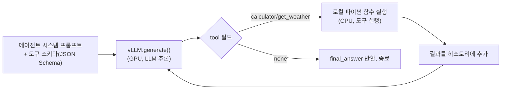

# 에이전트 루프 병목 실측 — 오픈 모델 기반

vLLM으로 TinyLlama-1.1B를 직접 서빙해서 실제 동작하는 툴콜(tool-calling) 에이전트 루프를 만들고,
(1) 구조화된 디코딩(structured/guided decoding)이 JSON 신뢰성 문제를 실제로 해결하는지,
(2) 그 루프에서 시간이 GPU(LLM 추론)와 CPU(도구 실행) 중 어디에 더 쓰이는지를 직접 측정한 실습입니다.

Colab T4 GPU에서 [`agent_loop_bottleneck.ipynb`](agent_loop_bottleneck.ipynb)를 실제로 실행해서 얻은 결과입니다.

## 구조



## 실험 1 — 구조화된 디코딩이 JSON 신뢰성을 실제로 고치는가

같은 프롬프트(`"What's the weather in Seoul?"`)를 5번 반복 생성, `temperature=0.7`(무작위성 있게)로 tool-call JSON이 실제로 파싱 가능한 형태로 나오는지 확인.

| 조건 | 결과 |
|---|---|
| 구조화된 디코딩 없음 (`SamplingParams(temperature=0.7, max_tokens=80)`) | **0/5** |
| 구조화된 디코딩 적용 (`StructuredOutputsParams(json=TOOL_SCHEMA)`) | **5/5** |

```python
from vllm.sampling_params import StructuredOutputsParams
so = StructuredOutputsParams(json=TOOL_SCHEMA)
sp_guided = SamplingParams(temperature=0.7, max_tokens=80, structured_outputs=so)
```

**핵심 발견**: TinyLlama-1.1B처럼 작은 모델은 프롬프트로 "JSON으로만 답하라"고 지시해도 온도(temperature)가 0보다 크면 스키마를 거의 못 지킵니다(5번 중 0번). vLLM의 구조화된 디코딩(로짓 레벨에서 스키마를 벗어나는 토큰 자체를 마스킹)을 켜자 5번 모두 스키마를 만족하는 JSON이 나왔습니다 — 이전 세션에서 정리한 "서빙 엔진이 에이전틱 워크로드에 기여할 수 있는 지점" 중 구조화된 디코딩 항목을 직접 검증한 결과입니다.

<details>
<summary>참고: 이 vLLM 버전의 실제 API (문서와 이름이 다름)</summary>

`from vllm.sampling_params import GuidedDecodingParams`로 처음 시도했더니 `ImportError`가 났습니다. 설치된 버전(2026-09 기준 최신 vLLM)에서는 `guided_decoding`/`GuidedDecodingParams`가 `structured_outputs`/`StructuredOutputsParams`로 이름이 바뀌어 있었습니다. `dir(vllm.sampling_params)`로 실제 존재하는 이름을 직접 확인해서 고쳤습니다 — 문서/기억에 의존하지 않고 실행해서 확인하는 게 중요하다는 걸 다시 확인한 사례.
</details>

## 실험 2 — 실제 3턴 에이전트 루프에서 GPU vs CPU 시간 비중

과제: *"서울 날씨를 확인하고, 필요하면 계산기로 15×23을 계산한 다음, 최종 답을 달라"* — 구조화된 디코딩을 켠 채로 실제 3턴(LLM 호출 3회, 도구 실행 2회)을 실행하고 각 구간의 wall-clock 시간을 직접 측정.

| 구간 | 시간 | 비중 |
|---|---|---|
| LLM 추론 (GPU-bound, 3회 호출) | 2.763s | **64.8%** |
| 도구 실행 (CPU/IO-bound, 2회 호출 — `get_weather`에 1.5초 인위 지연 포함) | 1.501s | **35.2%** |

**실제 실행 로그**:
```
Turn A: tool=calculator input=15 result=15
Turn B: tool=get_weather input=Seoul result=Seoul: 25C, sunny
Turn C: tool=get_weather final_answer=27
```

## 정직한 한계 — 구조화된 디코딩은 "형식"만 고친다

실험 1에서 스키마 준수는 5/5로 완벽했지만, **내용은 엉망**이었습니다:
- Turn A의 `thought`: *"How many times 23 is equal to 15 in the given city?"* — 의미가 통하지 않는 문장이고, `tool_input`도 `"15"`뿐이라 계산기가 `15*23`이 아니라 그냥 `15`를 돌려줌
- Turn C에서 이미 날씨와 계산 결과를 다 가지고 있었는데도 `tool=none`으로 못 넘어가고 다시 `get_weather`를 호출 — 루프 종료 조건을 스스로 판단하지 못함
- `final_answer`(`"27"`, `"17 minutes"`)도 실제 도구 결과(`15`, `Seoul: 25C, sunny`)와 논리적으로 연결되지 않음

**결론**: 구조화된 디코딩(vLLM의 `structured_outputs`)은 **"JSON이 스키마를 지키는가"**라는 구조적 신뢰성 문제는 확실히 해결하지만, **"모델이 논리적으로 맞는 내용을 채우는가"**라는 추론 능력의 문제는 전혀 건드리지 않습니다. 이건 서빙 엔진(vLLM/LPU)이 아니라 모델 자체의 역량 문제라, HyperAccel 같은 서빙/가속기 회사의 소프트웨어가 풀 수 있는 범위 밖이라는 걸 실측으로 직접 확인한 것 — "어디까지가 서빙 엔진의 책임이고 어디부터가 모델의 책임인가"를 명확히 가르는 근거입니다.

## GPU:도구 시간 비율에 대한 솔직한 평가

이번 측정(GPU 64.8% : 도구 35.2%)은 이 토이 예제의 `get_weather` 인위 지연(1.5초)에 크게 좌우됩니다. 실제 프로덕션 에이전트(코드 실행, 웹 검색, 외부 API 호출 등)의 도구 지연은 이보다 훨씬 크고 가변적이라, 조지아공대 논문(arXiv:2511.00739, [LPU 경쟁 구도 노트](../vllm-serving-tuning-practice) 참고)이 보고한 "CPU/도구 처리가 지연의 최대 90%" 수치와 직접 비교하기엔 이 실험의 규모가 너무 작습니다. 이 실험의 가치는 정확한 비율 자체보다 **"이 비율을 실제로 코드 3줄(`t0 = time.time(); ...; t_llm_total += ...`)로 직접 계측할 수 있다"**는 재현 가능한 방법론에 있습니다.

## 재현 방법
1. Colab에서 [`agent_loop_bottleneck.ipynb`](agent_loop_bottleneck.ipynb) 열기
2. 런타임 > 런타임 유형 변경 > **T4 GPU**
3. 위에서부터 순서대로 실행 (vLLM 설치에 3~5분 소요)
