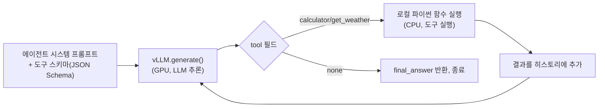
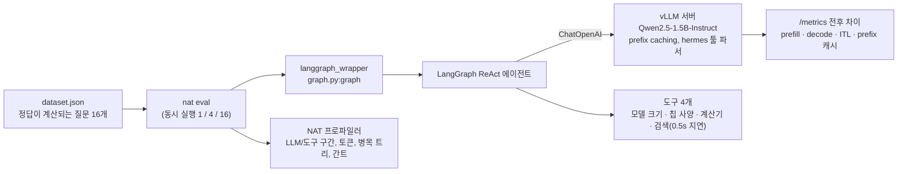

# 에이전트 루프는 어디에서 시간을 쓰나: 오픈 모델로 직접 재 보기

도구를 부르는 에이전트 루프를 vLLM으로 직접 돌리면서, 궁금했던 것을 하나씩 재 본 기록입니다.

1. 구조화된 디코딩을 켜면 도구 호출 JSON이 깨지지 않는가. TinyLlama-1.1B, temperature 0.7로 다섯 번 뽑았을 때 끄면 0/5, 켜면 5/5가 파싱됐습니다. 다만 고쳐지는 건 형식뿐입니다(아래 '한계' 절).
2. 루프의 시간은 GPU(추론)와 CPU(도구 실행) 중 어디에 드는가. Colab T4와 로컬 RTX 3060 Ti에서 LangGraph, vLLM, NVIDIA NeMo Agent Toolkit으로 다시 쟀습니다.
3. 7B 모델에서 KV 캐시를 fp8로 줄이면 왜 도구 호출 정답률이 0 %가 되나. 커널, 캐시 쓰기, 백엔드를 하나씩 빼 보니 원인은 0번과 27번 레이어의 K 값 이상치였고, 범위가 더 넓은 e5m2가 더 나빴던 걸 보면 범위보다 가수 비트(정밀도)가 문제였습니다. 그 두 레이어만 fp16으로 두니 50 %까지 돌아왔습니다(fp16 전체는 56 %).

실험 1·2는 [`agent_loop_bottleneck.ipynb`](agent_loop_bottleneck.ipynb)를 Colab T4에서 돌린 결과이고, 실험 3은 로컬 RTX 3060 Ti 결과입니다.

## 구조



## 실험 1: 구조화된 디코딩이 JSON 깨짐을 막는가

같은 프롬프트(`"What's the weather in Seoul?"`)를 5번 반복 생성, `temperature=0.7`(무작위성 있게)로 tool-call JSON이 실제로 파싱 가능한 형태로 나오는지 확인.

| 조건 | 결과 |
|---|---|
| 구조화된 디코딩 없음 (`SamplingParams(temperature=0.7, max_tokens=80)`) | 0/5 |
| 구조화된 디코딩 적용 (`StructuredOutputsParams(json=TOOL_SCHEMA)`) | 5/5 |

```python
from vllm.sampling_params import StructuredOutputsParams
so = StructuredOutputsParams(json=TOOL_SCHEMA)
sp_guided = SamplingParams(temperature=0.7, max_tokens=80, structured_outputs=so)
```

핵심 발견: TinyLlama-1.1B처럼 작은 모델은 프롬프트로 "JSON으로만 답하라"고 지시해도 온도(temperature)가 0보다 크면 스키마를 거의 못 지킵니다(5번 중 0번). vLLM의 구조화된 디코딩(로짓 레벨에서 스키마를 벗어나는 토큰 자체를 마스킹)을 켜자 5번 모두 스키마를 만족하는 JSON이 나왔습니다: 이전 세션에서 정리한 "서빙 엔진이 에이전틱 워크로드에 기여할 수 있는 지점" 중 구조화된 디코딩 항목을 직접 검증한 결과입니다.

<details>
<summary>참고: 이 vLLM 버전의 실제 API (문서와 이름이 다름)</summary>

`from vllm.sampling_params import GuidedDecodingParams`로 처음 시도했더니 `ImportError`가 났습니다. 설치된 버전(2026-09 기준 최신 vLLM)에서는 `guided_decoding`/`GuidedDecodingParams`가 `structured_outputs`/`StructuredOutputsParams`로 이름이 바뀌어 있었습니다. `dir(vllm.sampling_params)`로 실제 존재하는 이름을 직접 확인해서 고쳤습니다: 문서/기억에 의존하지 않고 실행해서 확인하는 게 중요하다는 걸 다시 확인한 사례.
</details>

## 실험 2: 3턴 에이전트 루프에서 GPU와 CPU 시간

과제: *"서울 날씨를 확인하고, 필요하면 계산기로 15×23을 계산한 다음, 최종 답을 달라"*: 구조화된 디코딩을 켠 채로 실제 3턴(LLM 호출 3회, 도구 실행 2회)을 실행하고 각 구간의 wall-clock 시간을 직접 측정.

| 구간 | 시간 | 비중 |
|---|---|---|
| LLM 추론 (GPU-bound, 3회 호출) | 2.763s | 64.8% |
| 도구 실행 (CPU/IO-bound, 2회 호출: `get_weather`에 1.5초 인위 지연 포함) | 1.501s | 35.2% |

실제 실행 로그:
```
Turn A: tool=calculator input=15 result=15
Turn B: tool=get_weather input=Seoul result=Seoul: 25C, sunny
Turn C: tool=get_weather final_answer=27
```

## 한계: 구조화된 디코딩은 형식만 고친다

실험 1에서 스키마 준수는 5/5로 완벽했지만, 내용은 엉망이었습니다:
- Turn A의 `thought`: *"How many times 23 is equal to 15 in the given city?"*: 의미가 통하지 않는 문장이고, `tool_input`도 `"15"`뿐이라 계산기가 `15*23`이 아니라 그냥 `15`를 돌려줌
- Turn C에서 이미 날씨와 계산 결과를 다 가지고 있었는데도 `tool=none`으로 못 넘어가고 다시 `get_weather`를 호출: 루프 종료 조건을 스스로 판단하지 못함
- `final_answer`(`"27"`, `"17 minutes"`)도 실제 도구 결과(`15`, `Seoul: 25C, sunny`)와 논리적으로 연결되지 않음

결론: 구조화된 디코딩(vLLM의 `structured_outputs`)은 "JSON이 스키마를 지키는가"라는 구조적 신뢰성 문제는 확실히 해결하지만, "모델이 논리적으로 맞는 내용을 채우는가"라는 추론 능력의 문제는 전혀 건드리지 않습니다. 이건 서빙 엔진(vLLM/LPU)이 아니라 모델 자체의 역량 문제라, HyperAccel 같은 서빙/가속기 회사의 소프트웨어가 풀 수 있는 범위 밖이라는 걸 실측으로 직접 확인한 것: "어디까지가 서빙 엔진의 책임이고 어디부터가 모델의 책임인가"를 명확히 가르는 근거입니다.

## GPU와 도구 시간 비율은 어떻게 봐야 하나

이번 측정(GPU 64.8% : 도구 35.2%)은 이 토이 예제의 `get_weather` 인위 지연(1.5초)에 크게 좌우됩니다. 실제 프로덕션 에이전트(코드 실행, 웹 검색, 외부 API 호출 등)의 도구 지연은 이보다 훨씬 크고 가변적이라, 조지아공대 논문(arXiv:2511.00739, [LPU 경쟁 구도 노트](../vllm-serving-tuning-practice) 참고)이 보고한 "CPU/도구 처리가 지연의 최대 90%" 수치와 직접 비교하기엔 이 실험의 규모가 너무 작습니다. 이 실험의 가치는 정확한 비율 자체보다 "이 비율을 실제로 코드 3줄(`t0 = time.time(); ...; t_llm_total += ...`)로 직접 계측할 수 있다"는 재현 가능한 방법론에 있습니다.

## 실험 3: 실제로 많이 쓰는 도구 조합으로 다시 재기 (로컬 RTX 3060 Ti)

실험 1·2는 직접 짠 간단한 루프에 TinyLlama를 붙인 것이었습니다. 실제 서비스와 거리가 있어서, 이번에는 현업에서 많이 쓰는 조합으로 다시 쟀습니다.

- 에이전트: LangGraph로 만든, 도구를 부르며 문제를 푸는 에이전트
- 모델 서버: vLLM (OpenAI API와 같은 형식으로 요청을 받음)
- 측정: NVIDIA NeMo Agent Toolkit(NAT). 에이전트가 LLM을 부른 시간과 도구를 부른 시간을 구간별로 기록해 줍니다. 여기에 vLLM이 내보내는 지표(`/metrics`)를 실행 전후로 받아서 서버 쪽 시간도 맞춰 봤습니다.

코드와 원본 기록은 [`nat_langgraph/`](nat_langgraph/)에 있습니다.



문제는 "Llama-3.1-8B를 fp16으로 A100 한 장에서 돌리면 토큰 하나 만드는 데 최소 몇 ms인가" 같은 계산 문제 16개입니다. 에이전트는 도구로 모델 크기와 칩의 메모리 대역폭을 찾아보고, 계산기로 계산해야 풉니다. 답이 계산으로 정해지니 자동으로 채점할 수 있습니다. 최종 답의 숫자가 정답의 ±5 % 안이면 맞은 것으로 쳤습니다.

설정은 vLLM 0.11.2, NAT 1.9.0, LangGraph 1.2.15, `temperature=0`, `--max-model-len 8192`, `--gpu-memory-utilization 0.80`입니다. 동시에 돌리는 에이전트 수(1, 4, 16)마다 3번씩 돌리고 가운데 값을 썼습니다. 매번 시작 전에 vLLM의 prefix 캐시(앞에서 계산해 둔 결과)를 비워서 조건을 같게 맞췄습니다.

### 결과: Qwen2.5-1.5B-Instruct (bf16)

표를 읽기 전에 용어 몇 개만 먼저 짚겠습니다.

- prefill: 입력 문장을 한 번에 읽어 들이는 단계
- 디코드: 답을 한 토큰씩 만들어 내는 단계
- TTFT: 요청을 보내고 첫 토큰이 나올 때까지 걸린 시간
- ITL: 토큰과 토큰 사이의 시간

| 동시 에이전트 | 처리량 (질문/분) | 질문당 지연 p50 / p95 | 에이전트 시간 중 디코드 | 중 prefill | 중 도구 | TTFT | 토큰 간 지연(ITL) |
|---|---|---|---|---|---|---|---|
| 1 | 21.2 | 2.29s / 7.62s | 92.2% | 1.8% | 4.6% | 27ms | 12.6ms |
| 4 | 85.8 | 2.12s / 7.22s | 89.7% | 1.8% | 4.8% | 50ms | 11.9ms |
| 16 | 121.0 | 2.81s / 7.92s | 80.6% | 3.8% | 3.9% | 182ms | 13.4ms |

질문 하나에 LLM을 평균 2번 불렀고, 입력은 약 1,200토큰, 출력은 약 210토큰이었습니다. prefix 캐시 적중률은 모든 조건에서 약 87 %였습니다. 원본은 [`nat_langgraph/results/summary.json`](nat_langgraph/results/summary.json)과 실행별 NAT 출력(`all_requests_profiler_traces.json`, `gantt_chart.png`, `workflow_profiling_report.txt`)에 있습니다.

이 결과에서 알 수 있었던 것은 이렇습니다.

1. 에이전트가 쓴 시간의 약 90 %는 디코드였습니다. 입력이 출력보다 6배 길었는데도 prefill은 2 % 정도였습니다. 시스템 프롬프트와 도구 설명이 모든 질문에서 같고, 두 번째 LLM 호출은 첫 번째 대화를 그대로 다시 보내기 때문에, vLLM이 앞에서 계산해 둔 결과(prefix 캐시)를 87 % 다시 쓸 수 있었습니다. 일부러 0.5초 걸리게 만든 도구를 넣었는데도 도구 시간은 5 % 안팎이었습니다.
2. 디코드 중 GPU 메모리 대역폭은 절반 남짓만 쓰였습니다. 디코드는 토큰 하나를 만들 때마다 모델 가중치 전체(3.09 GB)를 메모리에서 읽어야 합니다. 동시 1일 때 토큰 간격이 12.6 ms였으니 초당 245 GB를 읽은 셈이고, 이 GPU의 사양(448 GB/s)의 55 %입니다. 같은 GPU에서 서버 없이 잰 값([vllm-serving-tuning-practice](https://github.com/Thisish3/vllm-serving-tuning-practice) 실험 5, 65 %)보다 낮은데, 서버로 돌리면 API 서버와 스케줄러가 토큰마다 쓰는 시간도 같이 들어가기 때문으로 봅니다(따로 나눠 재지는 않았습니다).
3. 동시에 돌리는 에이전트를 1개에서 16개로 늘리자 처리량은 5.7배가 됐습니다. 토큰 간격은 6 %만 늘었지만, 첫 토큰까지의 시간은 27 ms에서 182 ms로 늘었습니다. 새로 들어온 요청의 prefill이 이미 돌고 있는 디코드와 GPU를 나눠 쓰기 때문입니다.

LPU였다면 얼마나 빨라질지도 대략 계산해 봤습니다. 하이퍼엑셀은 LPU가 메모리 대역폭을 약 90 % 쓴다고 발표했습니다(GPU는 50~60 %). 이 숫자를 그대로 쓰고 디코드 시간만 55 % → 90 % 비율로 줄어든다고 치면, 동시 1에서 에이전트 전체 시간은 `1 − 0.922 × (1 − 0.55/0.90) ≈ 0.64`, 약 36 % 줄어듭니다(동시 4는 32 %, 16은 35 %). 이건 측정이 아니라 회사 발표 숫자를 넣은 단순 계산입니다. "에이전트 시간의 90 %가 디코드"라는 부분만 직접 잰 값입니다.

### 작은 모델은 문제를 거의 못 풀었습니다

1.5B 모델은 16문제 중 1문제만 맞혔습니다(6 %). 왜 틀렸는지 NAT 기록에서 도구에 넘긴 값을 하나씩 봤습니다. 대부분은 두 가지였습니다.

- 순서를 지키지 않았습니다. 조회 도구 두 개와 계산기를 한 번에 같이 불러서, 조회 결과가 오기도 전에 자기가 기억하는 숫자로 계산해 버렸습니다.
- 공식을 거꾸로 썼습니다. ms를 구하라는데 tok/s를 계산하는 식이었습니다.

채점기도 하나 고쳤습니다. 처음에는 "답 안에 정답과 ±5 % 안의 숫자가 하나라도 있으면 정답"으로 봤는데, 모델이 질문에 있던 숫자(파라미터 수)를 그대로 적은 답까지 정답으로 쳐 주고 있었습니다(3개 중 2개). 그래서 최종 답 숫자만 보도록 바꿨습니다.

### 7B 모델로 다시

그래서 Qwen2.5-7B-Instruct를 4비트로 줄인 버전(AWQ)으로 다시 돌렸습니다. 7B는 8 GB에 간신히 들어가서 설정을 줄였습니다(`--max-model-len 3072`, `--max-num-seqs 8`, `--gpu-memory-utilization 0.85`). 설정이 다르니 속도는 위 표와 그대로 비교하면 안 됩니다. 이때는 fp8 KV 캐시도 켜 보지 못했는데, 필요한 커널(FlashInfer)을 빌드하려면 CUDA 컴파일러가 있어야 했고 그때는 설치되어 있지 않았습니다.

| 모델 | 동시 | 정답률 | 질문당 LLM 호출 | 처리량 (질문/분) | 디코드 비중 | ITL | 실효 대역폭 (사양 대비) | LPU 추정 |
|---|---|---|---|---|---|---|---|---|
| Qwen2.5-1.5B (bf16) | 1 | 1/16 (6%) | 2.0 | 21.2 | 92.2% | 12.6ms | 245GB/s (55%) | −36% |
| Qwen2.5-7B-AWQ (4bit) | 1 | 8/16 (50%) | 2.7 | 17.1 | 90.9% | 14.9ms | 301GB/s (67%) | −23% |
| Qwen2.5-7B-AWQ (4bit) | 4 | 9/16 (56%) | 2.6 | 58.6 | 88.4% | 16.2ms | 276GB/s (62%) | −28% |

(7B가 토큰마다 읽는 가중치는 입력 임베딩을 뺀 4.48 GB로 계산했습니다. 원본: [`nat_langgraph/results_7b/summary.json`](nat_langgraph/results_7b/summary.json))

- 7B는 조회 결과를 먼저 받고 나서 계산하는 식으로 단계를 나눴습니다. 그래서 LLM을 더 자주 불렀고(2.0 → 2.7회), 정답률은 8배가 됐습니다. 틀린 8개 중 4개는 tok/s 문제(공식과 단위 혼동), 2개는 메모리 GB 문제, 2개는 ms 문제였습니다(동시 1, 첫 번째 실행 기준).
- 모델이 바뀌어도 에이전트 시간의 약 90 %가 디코드라는 점은 같았습니다.
- 4비트 AWQ 커널은 같은 GPU에서 대역폭을 67 %까지 썼습니다. 그래서 90 %를 가정했을 때 남는 개선 여지는 23 %로 줄었습니다. 양자화 커널을 잘 짜는 것도 결국 "대역폭을 얼마나 알뜰하게 쓰느냐"의 문제라는 뜻입니다.

### 7B를 동시 16까지: fp16 KV 재측정과 fp8 KV 시도

이후 CUDA 툴킷을 깔아 FlashInfer JIT 빌드를 살리고, 같은 서버 설정(`--max-model-len 3072 --max-num-seqs 16 --gpu-memory-utilization 0.85 --swap-space 0`)에서
KV 캐시 자료형만 바꿔 동시 1/4/16을 3회씩 다시 쟀습니다. KV 용량은 fp16 24,064토큰, fp8 47,264토큰이었습니다.

| KV | 동시 | 정답률 | 질문당 LLM 호출 | 처리량 (질문/분) | 지연 p50 / p95 | 디코드 비중 | TTFT | ITL | 실효 대역폭 (사양 대비) |
|---|---|---|---|---|---|---|---|---|---|
| fp16 | 1 | 8/16 (50%) | 2.7 | 18.3 | 2.49s / 6.80s | 90.9% | 46ms | 13.9ms | 323GB/s (72%) |
| fp16 | 4 | 8/16 (50%) | 2.6 | 62.1 | 3.03s / 7.28s | 88.0% | 96ms | 15.3ms | 293GB/s (65%) |
| fp16 | 16 | 8/16 (50%) | 2.7 | 105.5 | 4.58s / 9.08s | 77.8% | 348ms | 20.0ms | 224GB/s (50%) |
| fp8 (e4m3, 스케일 없음) | 1 | 0/16 (0%) | 1.0 | (무효) | | | | 16.2ms | |

(원본: [`nat_langgraph/results_7b_fp16/summary.json`](nat_langgraph/results_7b_fp16/summary.json), [`results_7b_fp8/`](nat_langgraph/results_7b_fp8/))

- fp16: 동시 1 → 16에서 처리량은 5.8배가 됐고, 대가는 지연(p50 2.5 → 4.6초)과 TTFT(46 → 348ms)로 왔습니다.
  배치가 커지면 스텝마다 KV 읽기가 늘어 가중치 기준 대역폭 활용률은 72% → 50%로 떨어집니다(가중치만 센 값이라 KV 읽기는 빠져 있음).
- fp8 KV는 출력을 망가뜨렸습니다. 모든 질문에서 도구를 한 번도 부르지 못하고, 약 400토큰짜리 깨진 반복 텍스트를 낸 뒤 끝났습니다.
  vLLM은 체크포인트에 KV 스케일이 없을 때 "정확도가 떨어질 수 있다"는 경고만 내고 스케일 1.0으로 돌립니다.
  그래서 속도 수치도 의미가 없습니다(호출 수와 출력 길이가 달라서 비교 불가).

왜 깨졌는지 좁혀 봤습니다 (재현 스크립트와 로그: [`nat_langgraph/fp8_kv/`](nat_langgraph/fp8_kv/))

| 확인 | 결과 | 배제되는 원인 |
|---|---|---|
| e4m3 + `--calculate-kv-scales` (스케일 동적 계산) 벤치 | 정답률 0/16, 질문당 호출 1.0 (그대로) | 스케일이 없어서 |
| e5m2 (지수 비트 5개, 범위 57,344) | "17*23?"에 "It seems you're?" | 표현 범위 부족 |
| fp16 KV + FlashInfer 백엔드 강제 | 정상 ("391") | FlashInfer JIT 빌드 자체 |
| fp8 + `--enforce-eager` / `-O0` | 똑같이 깨짐 | CUDA 그래프, torch.compile |
| FlashInfer fp8 커널 vs 같은 값을 fp16으로 푼 기준 (Qwen 형상, GQA 7) | 상대 오차 0.0002 | 어텐션 커널 버그 |
| vLLM `reshape_and_cache_flash` (캐시 쓰기) vs `torch` 캐스트 | 바이트 단위 일치 | 캐시 쓰기 버그 |
| Triton 백엔드로 우회 | e4m3: Ampere Triton에 `fp8e4nv` 없음, e5m2: vLLM이 e4m3만 허용(`assert`) | (이 GPU에서는 다른 길 없음) |

커널이 정확하니 남는 것은 양자화 자체입니다. 그래서 fp16 KV로 돌리는 vLLM에 훅을 걸어 실제 프롬프트의 레이어별 Q/K/V(RoPE 후)를 뽑고,
K/V만 fp8로 바꿨을 때 어텐션 출력이 얼마나 달라지는지 쟀습니다([`kv_outliers.py`](nat_langgraph/fp8_kv/kv_outliers.py), 43토큰, 28레이어).

| K/V 저장 방식 | 출력 오차 중앙값 | 최악 레이어 |
|---|---|---|
| e4m3, 스케일 1.0 (vLLM 기본) | 7.9% | 44.8% (0번) / 41.5% (27번) |
| e5m2 | 16.7% | 69.1% |
| e4m3 + 텐서 단위 스케일 | 8.2% | 50.5% |
| e4m3 + K 채널 단위 스케일 | 7.5% | 25.5% |
| e4m3, 크기 상위 1%는 fp16 유지 | 5.6% | 44.6% |
| e4m3, 크기 상위 5%는 fp16 유지 | 2.9% | 25.7% (0번), 27번은 2.7% |

- 원인은 범위가 아니라 정밀도와 이상치입니다. Qwen2.5의 K는 첫 레이어와 마지막 레이어에 최대 172, 417의 이상치가 있습니다(다른 레이어는 10~50).
  logit은 `q·k`라서 큰 K 값의 상대 오차가 그대로 큰 절대 오차가 되고, softmax가 다른 토큰을 고릅니다.
  mantissa가 2비트인 e5m2가 3비트인 e4m3보다 더 나빴고, 스케일을 맞춰도(범위만 바꿈) 나아지지 않은 것이 이를 뒷받침합니다.
- 이상치만 따로 높은 정밀도로 두면 오차가 3분의 1로 줄었습니다. 이것이 하이퍼엑셀 Oaken(ISCA 2025)이 하는 일입니다.
  레이어마다 오프라인으로 정한 기준값으로 토큰의 값을 세 그룹으로 나눕니다. 보통 값(middle, 약 90%)은 4비트,
  큰 이상치(outer, 4%)와 아주 작은 값(inner, 6%)은 5비트로 따로 양자화하고, 이상치는 sparse 형식으로 분리해 저장합니다.
  양자화와 복원은 연산 코어가 아니라 각 코어의 DMA 경로에 둔 전용 회로가 맡습니다.
  여기서는 단순 크기 기준 5% 분리만 재현했고, 실제로 끝까지 생성했을 때의 결과는 바로 아래 혼합 정밀도 실험에 있습니다.
- 서빙 관점: vLLM은 이 상황에서 경고 한 줄만 내고 정상 동작하는 것처럼 응답했습니다(HTTP 200, 지연도 정상 범위).
  에이전트 지표로 보면 "질문당 LLM 호출 1.0, 도구 호출 0"이라 바로 드러났습니다. KV 양자화를 켤 때는 처리량이 아니라 과제 정답률로 검증해야 한다는 근거입니다.
- 같은 고정 부하에서 fp8 KV의 디코드는 fp16보다 토큰당 약 27% 느렸습니다(13.8 → 17.5ms, Nsight 아래 측정). Ampere에는 fp8 연산기가 없어 읽은 뒤 변환하는 비용이 듭니다.
  용량은 2배(24k → 47k토큰)가 되지만, 이 GPU에서는 정확도와 속도를 둘 다 잃는 선택이었습니다.

레이어별 혼합 정밀도로 정답률을 되살려 봤습니다 (플러그인과 스크립트: [`fp8_kv/kv_emu/`](nat_langgraph/fp8_kv/kv_emu/), [`mixed_bench.sh`](nat_langgraph/fp8_kv/mixed_bench.sh))

실험에 쓴 vLLM 0.11.2는 모든 레이어에 KV 자료형 하나만 씁니다(레이어별 예외 옵션은 2026-03에 추가, 아래 런타임 관점 참고). 그래서 캐시는 fp16으로 두고, vLLM 일반 플러그인으로 `Attention.forward`를 감싸
K/V를 캐시에 쓰기 직전에 e4m3로 반올림했다가 되돌렸습니다. 이 반올림은 vLLM fp8 캐시 쓰기와 바이트 단위로 같은 연산이라(위 표)
정확도는 그대로 재현하고, 메모리 절약은 재현하지 않습니다. NAT 벤치 16문항, 동시 1·16 각 3회, 정답률은 중앙값 [최소, 최대]입니다.

| KV 저장 | fp16으로 남긴 것 | 정답률 (동시 1) | 정답률 (동시 16) | 질문당 LLM 호출 | 질문당 출력 | KV 용량 (계산) |
|---|---|---|---|---|---|---|
| off (대조군, 전부 fp16) | 전부 | 50% [50, 56] | 56% [50, 56] | 2.62 | 224토큰 | 24k |
| all (전부 e4m3) | 없음 | 0% | 0% | 1.00 | 397토큰 | 47k |
| keep0_27 | 0번, 27번 레이어 (2/28) | 25% [19, 50] | 50% [38, 69] | 2.62 | 262토큰 | 약 45k |
| keep8 | 단일 레이어 오차 상위 8개 | 38% [38, 50] | 44% [31, 50] | 2.69 | 241토큰 | 약 37k |
| top5 | 토큰마다 크기 상위 5% 값 | 6% | 6% | 1.25 | 112토큰 | 45k 미만 (위치 정보 별도) |

(원본: `nat_langgraph/results_7b_emu_*/summary.json`, 서버 로그 요약: [`fp8_kv/emu_logs/`](nat_langgraph/fp8_kv/emu_logs/). eager 모드라 지연 시간은 위 표들과 비교하지 않습니다.)

- 에뮬레이션이 실제 실패를 그대로 재현했습니다. all은 실제 fp8 실행과 같은 "11122" 응답, 정답 0, 호출 1.0회, 약 400토큰이었습니다.
  off는 기존 fp16 기준선(50%, 2.69회)과 같아서 플러그인과 eager 모드가 결과를 바꾸지 않았습니다.
- 레이어 2개(7%)만 fp16으로 두자 도구 호출이 정상으로 돌아왔고, 정답률은 동시 16에서 기준선 수준, 동시 1에서 절반 정도로 회복됐습니다.
  KV 용량은 fp8 이득의 약 90%를 유지합니다. 다만 회차별 편차가 커서(19~69%) 완전히 같다고 말할 수는 없습니다.
- 평균 오차가 가장 작던 방식이 실제로는 가장 나빴습니다. 위 오차 표에서 "상위 5% fp16"은 중앙값 2.9%로 1등이었지만, 실제 생성에서는 6%였습니다.
  그 계산은 텐서 전체에서 5%를 골라 이상치 레이어·채널에 fp16 예산이 몰렸고, 실제 실행 중에는 토큰 단위로만 고를 수 있어 토큰마다 512개 중 25개씩 고르게 나눠 가집니다.
  그 결과 오차가 가장 큰 0번 레이어가 여전히 망가졌습니다. 정확도를 결정한 것은 평균 오차가 아니라 최악 레이어를 지키느냐였습니다.
- 런타임 관점: 레이어별 KV 자료형은 블록 풀을 레이어마다 다른 크기로 나눠야 하는 기능이라 실험에 쓴 vLLM 0.11.2에는 없었습니다.
  이후 vLLM에 `--kv-cache-dtype-skip-layers`가 추가돼(2026-03, [#33695](https://github.com/vllm-project/vllm/pull/33695)) 지정한 레이어만 양자화에서 뺄 수 있습니다.
  keep0_27은 `--kv-cache-dtype fp8 --kv-cache-dtype-skip-layers 0 27`에 해당합니다. 이 옵션으로 실제 용량과 정답률을 다시 재는 것은 아직 하지 않았습니다.
  어느 레이어를 뺄지는 모델마다 다르므로, Oaken처럼 오프라인 프로파일링으로 정하거나 런타임이 레이어별 정밀도 정책을 받아야 안전하게 양자화할 수 있습니다.

### Nsight Systems: CPU 쪽 런타임 오버헤드

고정 부하(약 800토큰 프롬프트, 256토큰 출력 강제)를 `nsys --trace=cuda,nvtx --cuda-graph-trace=node`로 잡았습니다.
WSL2 + nsys 2023.2에서는 GPU 커널 기록이 수집되지 않아(커널 표가 비어 있음) CPU 쪽 CUDA API 기록만 분석했습니다.

| 동시 1 | 토큰당 시간 | CUDA 그래프 실행 | 그래프 밖 커널 실행 | GPU 결과 대기 (`cudaMemcpyAsync`) |
|---|---|---|---|---|
| fp16 KV | 13.8ms | 토큰당 1.1회, 평균 0.47ms | 토큰당 24회 (각 약 10µs) | 전체의 80% |
| fp8 KV | 17.5ms | 토큰당 1.1회, 평균 0.50ms | 토큰당 24회 + `cuLaunchKernelEx` 1회 | 전체의 79% |

CPU가 커널을 실행시키는 비용은 토큰당 약 0.7ms(약 5%)이고, 나머지는 GPU가 끝나기를 기다리는 시간입니다.
CUDA 그래프가 디코드 스텝을 한 번에 실행하기 때문입니다. 그러니 대역폭 활용률이 67~72%에 머무는 원인은 런타임 오버헤드가 아니라
커널 자체의 메모리 접근 효율입니다. 커널별 비중은 이 환경에서 잴 수 없었습니다.

### 토큰 회계: 에이전트 턴 사이에 KV를 지키는 값

7B 동시 1 트레이스의 LLM 호출 129개를 보면, 첫 호출은 프롬프트 516토큰(대부분 공통 시스템 프롬프트와 도구 스키마)에 출력 57토큰이고,
이후 호출은 프롬프트 중앙값 680토큰 중 새 토큰은 60개뿐입니다(92%는 직전 호출의 문맥).

| 다음 턴에서 직전 문맥을 | 비용 (680토큰 기준) |
|---|---|
| 다시 prefill | 약 0.49초 (이 GPU의 prefill 약 1,400토큰/초) |
| GPU에 유지 (새 60토큰만 prefill) | 약 0.04초 |
| CPU 메모리에서 다시 올림 (KV 토큰당 56KB, 약 38MB) | PCIe 기준 약 1.5ms |

한 턴의 디코드가 약 0.78초이므로, 버리면 턴 시간이 약 0.82초에서 1.27초로 55% 늘어납니다. 반면 옮기는 비용은 무시할 만큼 작습니다.
이 숫자로 세션 단위 KV 관리 시뮬레이터 [`kv_sim/`](kv_sim/)(C++)를 만들었습니다. 결론은 "누구를 내보낼까"보다 "새 세션을 언제 받을까"가 훨씬 중요하다입니다.
세션 단위 입장 제어만으로 같은 메모리에서 감당하는 부하가 약 2배가 됐고, 내보낼 대상을 완벽하게 고르는 oracle도 LRU와 1% 차이였습니다.

한계
- GPU 한 장, 1.5B 모델, 질문 16개 규모입니다. 큰 모델이나 긴 출력에서는 비중이 달라집니다.
- 실효 대역폭은 가중치만 셌고(KV 캐시 읽기 제외), ITL에는 서버의 토큰당 오버헤드가 섞여 있습니다.
- 도구는 로컬 함수와 0.5초 지연 하나뿐이라, 실제 웹 검색·코드 실행처럼 도구가 느린 에이전트에서는 도구 비중이 훨씬 커집니다(실험 2의 한계와 같음).
- LPU 추정은 회사가 밝힌 활용률을 그대로 넣은 계산입니다. LPU에서 직접 잰 값이 아닙니다.
- Nsight는 WSL2에서 GPU 커널을 수집하지 못해 CPU 쪽 API 기록만 썼습니다. fp16 동시 16 캡처는 프로파일러 아래에서 멈춰 버렸습니다.
- fp8 이상치 분석은 프롬프트 하나(43토큰)의 한 번의 prefill입니다. 혼합 정밀도 실험은 정확도만 에뮬레이션했고(캐시는 fp16),
  실제 용량 이득과 속도는 레이어별 자료형을 지원하는 런타임이 있어야 잴 수 있습니다. 16문항 × 3회라 정답률 편차가 큽니다.
- `kv_sim`은 측정값으로 맞춘 모델입니다. 문맥 길이에 따른 어텐션 비용과 오프로드 계층은 들어 있지 않습니다([`kv_sim/README.md`](kv_sim/README.md)).

### 하이퍼엑셀 LPU 자료와의 연결

공개 자료(논문 arXiv 2408.07326, Oaken arXiv 2503.18599, HyperDex 문서 v1.5.2) 기준입니다.

| 이 프로젝트의 측정 | 하이퍼엑셀 자료 | 연결 |
|---|---|---|
| 에이전트 시간의 78~92%가 디코드, GPU 대역폭 활용 50~72% | LPU 논문: 대역폭 활용 약 90%, 같은 논문의 H100 수치 29~71% | 에이전트 워크로드도 대역폭에 묶인 디코드가 지배합니다. 논문 평가(입력 32, 출력 2,016토큰)에는 없는 짧은 출력 · 다중 턴 패턴입니다 |
| 동시 16에서 활용률 72% → 50%, TTFT 7배 | 논문은 배치 1 디코드 중심, 배치는 향후 과제 | 에이전트 서빙은 동시 세션이 기본이라 배치 · 스케줄링이 런타임의 일이 됩니다 |
| 스케일 없는 fp8 KV에서 Qwen2.5 붕괴(정답 0%), 이상치 레이어 2개만 fp16으로 두면 도구 호출 복구·정답률 0 → 25~50% | Oaken: 레이어별 오프라인 기준값으로 이상치를 분리하는 KV 양자화(보통 값 4비트, 이상치 5비트) | 같은 문제의식을 실제 모델·실제 과제 정답률로 확인했습니다 |
| 턴 사이 문맥 92% 재사용, 재계산 0.49초 vs 전송 1.5ms | HyperDex 프리픽스 캐싱, 블로그의 CXL KV 오프로드 | 세션 단위 KV 유지 · 오프로드 · 입장 제어는 에이전트용 런타임에서 쓸모가 큽니다(`kv_sim`) |
| vLLM 백엔드가 fp8 여부에 따라 FlashAttention ↔ FlashInfer로 바뀜 | vLLM 지원(`vllm-orion`), GPU prefill + LPU decode 하이브리드 | 백엔드 · 자료형 조합마다 정확도 검증이 필요합니다 |

## 재현 방법

실험 3 (로컬 GPU, WSL2): `nat_langgraph/`에서
```bash
uv venv serve && VIRTUAL_ENV=serve uv pip install "vllm==0.11.2"
uv venv agent && VIRTUAL_ENV=agent uv pip install "nvidia-nat[langchain,profiler]==1.9.0" langgraph langchain-openai
agent/bin/python make_dataset.py
SERVE_VENV=$PWD/serve ./serve.sh
AGENT_VENV=$PWD/agent ./run_bench.sh
python analyze.py --weight-bytes 3087467144 --peak-gbps 448
```
7B: `VLLM_MODEL=Qwen/Qwen2.5-7B-Instruct-AWQ MAX_LEN=3072 GPU_UTIL=0.85 EXTRA_ARGS="--max-num-seqs 16 --swap-space 0 [--kv-cache-dtype fp8]" ./serve.sh`
(fp8 KV는 FlashInfer JIT 빌드를 위해 `CUDA_HOME`이 필요), 벤치는 `NAT_OVERRIDES="--override workflow.env.VLLM_MODEL Qwen/Qwen2.5-7B-Instruct-AWQ"`,
분석은 `--weight-bytes 4480752640`. fp8 원인 분석 스크립트는 `nat_langgraph/fp8_kv/`, 시뮬레이터는 `kv_sim/sweep.sh`.
혼합 정밀도: `uv pip install --python serve/bin/python -e fp8_kv/kv_emu` 후 `./fp8_kv/mixed_bench.sh`(`VARIANTS="off all keep0_27 keep8 top5"`).

실험 1·2 (Colab):
1. Colab에서 [`agent_loop_bottleneck.ipynb`](agent_loop_bottleneck.ipynb) 열기
2. 런타임 > 런타임 유형 변경 > T4 GPU
3. 위에서부터 순서대로 실행 (vLLM 설치에 3~5분 소요)
